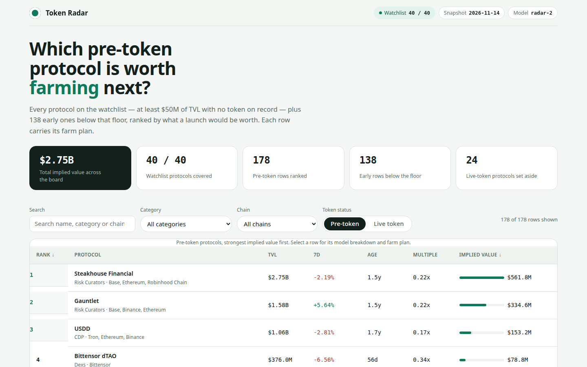
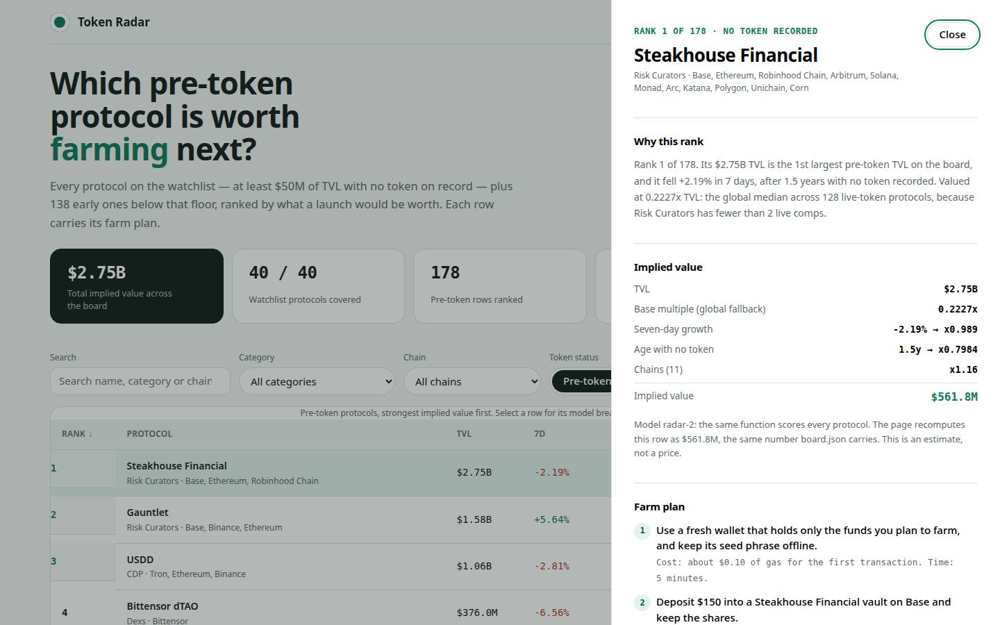
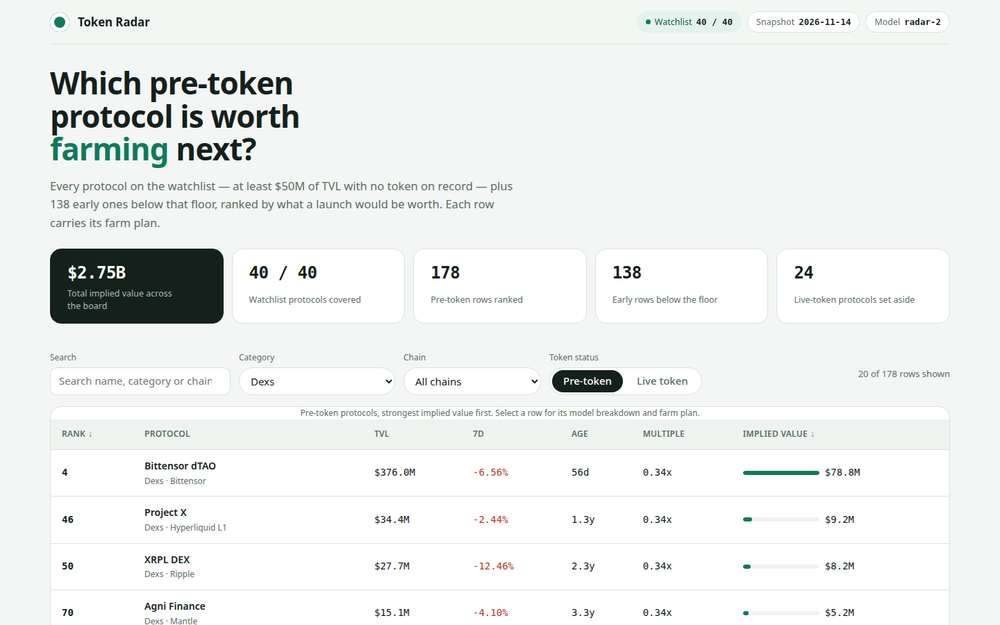

# Token Radar — which pre-token protocol is worth farming next?

[](https://make.fun/bounty/token-radar-01)
[](https://make.fun/bounty/token-radar-01)
[](https://make.fun/bounty/token-radar-01)

An entry for the [make.fun token-radar-01 bounty](https://make.fun/bounty/token-radar-01):
a program that reads a sealed snapshot of every protocol DefiLlama tracks and writes a web
dashboard ranking the protocols that record no token yet by what their launch would be worth —
each with the steps to farm it.

## What it does

- **Covers the whole watchlist (40/40)** — every protocol with at least $50M of TVL and no token
  on record — plus 138 early pre-token protocols below that floor: 178 rows in all.
- **Ranks by an implied value derived from the snapshot itself.** The base multiple is the median
  mcap/TVL of the live-token protocols in the same category (global median as fallback), adjusted
  by 7-day growth, how long the protocol has run with no token, and how many chains it runs on.
  No protocol name is special-cased.
- **Keeps the board honest.** Wrapped, staked and bridged products of tokens that already trade
  (144 of them) are excluded — they have no launch of their own to rank — and protocols above the
  floor that the watchlist leaves out are set aside rather than ranked on an unverifiable record.
- **Every row carries a 7-step farm plan** with what each step costs and how long it takes, derived
  from the protocol's category, chains, TVL and age.
- **The dashboard is a page a reader can use:** sortable table, search, category and chain filters,
  a live-token view set apart with market caps, a detail drawer per protocol (why its rank, the
  model's full breakdown, the farm plan), and the model stated in full. It renders with no network.

## Run it

Node.js 22.18 or later, standard library only — nothing to install.

```sh
mkdir -p out && MAKEFUN_OUTPUT_DIR=out node main.ts --input <snapshot.json>
```

That writes `out/board.json` (the ranked board), `out/data.js` (the dashboard's data),
`out/dashboard/` (the page), `out/screenshots/` and `out/dossier.json` (what the judge reads).
Run it twice: both runs write the same bytes.

## Layout

- `main.ts` — the entrypoint: reads the snapshot, scores the board, writes `/output`.
- `lib/model.ts` — the radar-2 model, the farm plans, the snapshot parser.
- `dashboard/` — `index.html`, `app.css`, `app.js`: the static page (no network).
- `vendor/makefun-board.ts` — make.fun's dossier library, as the kit ships it.
- `screenshots/` — the board, a protocol's detail view, and a filtered view.

## Screenshots





## Notes

Implied value is this entry's model, not a price and not a promise. A protocol "records no
token" on DefiLlama's record; that is not proof it has none. Data: DefiLlama protocol index,
snapshot as of 2026-11-14, sealed for the competition.

Built with [make.fun](https://make.fun/r/e0ar5hn0) — referral code `e0ar5hn0`.

## License

MIT — see [LICENSE](LICENSE).
